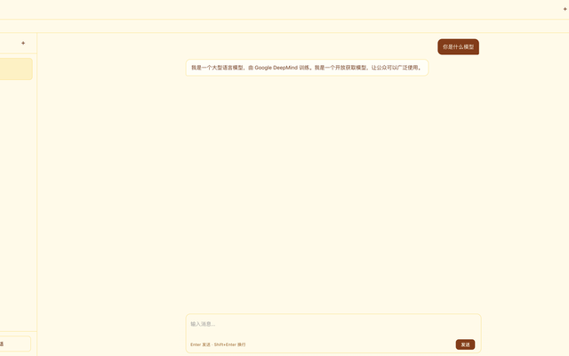
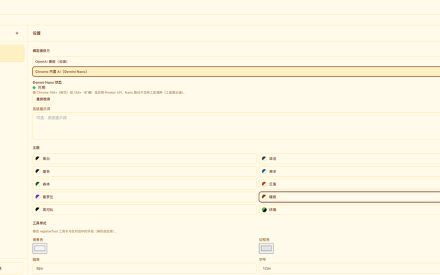
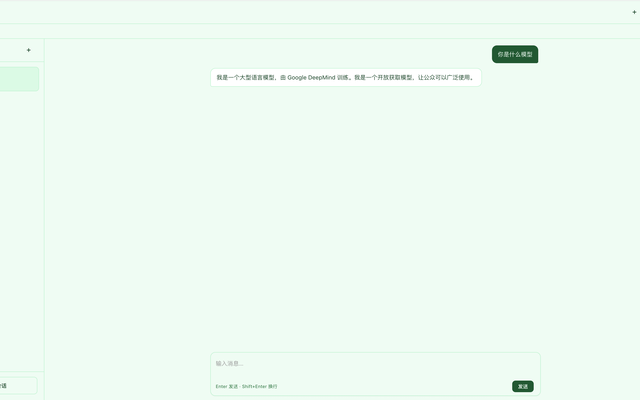

# SimpleChat

[English](./README_EN.md) | 中文

**Chrome 扩展：端侧离线 AI 对话，简单便捷。** 基于 Chrome 内置 **Gemini Nano**（Prompt API），对话在本机完成——**无需 API Key、无需联网、隐私不出设备**。也可一键切换 OpenAI 兼容云端。

- 仓库：https://github.com/SimpleAI2026/SimpleChat
- 亮点：**离线聊天** · **端侧 Gemini Nano** · **零配置开聊** · **界面简洁**

> 规划文档见 [`plan/`](./plan/)。本仓库同时提供可嵌入的 OpenAI 兼容聊天 SDK（见下方 [开发者 / 嵌入](#开发者--嵌入)）；面向用户的主入口是 **Chrome 扩展**。


## 界面预览

| 全页对话（左列表 + 居中消息） | 设置（云端 / 端侧 Gemini Nano） |
| :---: | :---: |
|  |  |



## 为什么用 SimpleChat？

| 亮点 | 说明 |
| --- | --- |
| **离线对话** | 端侧 Gemini Nano，断网也能聊 |
| **无需 API Key** | Nano 路径不上传、不落云，隐私友好 |
| **简单便捷** | 安装扩展 → 点图标 → 开聊；设置少、界面清 |
| **云端可选** | 需要更强模型或工具调用时，切换 OpenAI 兼容 API |
| **Chrome 138+** | 扩展侧 Prompt API / Gemini Nano 需 Chrome **138+** |

## 快速开始（Chrome 扩展）

### 从源码加载（开发 / 自用）

```bash
yarn install
yarn build:extension
# 或 yarn build:all
```

1. 打开 `chrome://extensions`
2. 开启「开发者模式」
3. **加载已解压的扩展程序** → 选择仓库根目录下的 `dist-extension`
4. 点击扩展图标，打开全页聊天标签

`<simple-chat layout="extension">`：左侧常驻会话列表、中间更宽消息列（气泡约 640–720px）、设置抽屉保留全部能力。关闭按钮在扩展布局下隐藏。

### 使用 Chrome 内置 AI（Gemini Nano）

1. 使用 **Chrome 138+**，并启用 Prompt API / Gemini Nano（按 Chrome 官方说明）。
2. 打开扩展 → 右上角 **⚙ 设置** → 提供方选择 **Chrome 内置 AI（Gemini Nano）**。
3. 查看状态：不可用 / 可下载 / 下载中 % / 可用；可「重新检测」「下载模型」。
4. Nano 就绪后即可发送；**无需填写 API Key**。

说明：

- Nano 走 `globalThis.LanguageModel`（Prompt API），对话在设备本地完成。
- **工具调用仅云端**（Nano 路径 v1 跳过 `registerTool`，UI 提示「工具需云端」）。
- 默认：无 API Key 且 LanguageModel 可用/可下载时优先 `chrome-ai`。
- Nano 未就绪时会阻止发送并给出引导。
- 网页嵌入场景约需 Chrome **148+**；**扩展约 138+**。

### 可选：云端 OpenAI 兼容

⚙ → 提供方选 **OpenAI 兼容（云端）**，填写 Base URL / API Key / Model。云端请求依赖 `host_permissions`（默认 `https://*/*`）。

---

## Packages

| Package | 说明 |
| --- | --- |
| `@simplechat/core` | `ChatEngine`、工具注册、IndexedDB / Memory 历史、SSE 流式、`normalizeSecret` |
| `@simplechat/element` | `<simple-chat>` Web Component（Shadow DOM + `--sc-*`） |
| `@simplechat/vue` | Vue 3 薄封装 `SimpleChatSidebar`（monorepo 内使用） |
| `@simplechat/demo` | Vite Demo：配置面板 + 侧栏 + 示例工具 |
| Chrome 扩展 | `yarn build:extension` → `dist-extension/` 全页 `layout="extension"` |

---

## 开发者 / 嵌入

纯前端、可嵌入的 **OpenAI 兼容** 侧栏聊天 SDK。宿主传入 `apiBaseUrl` / `apiKey` / `model`，并可 `registerTool` 让模型调用浏览器内宿主 API。默认 UI 为 shadcn 风格黑白主题。宿主接入（如 SimpleMind）通过 **浏览器 min bundle 拷贝**，**不**走 Yarn portal / npm link。本仓库实现 Phase P0–P4（Core / Web Component / Vue 薄封装 / Demo）。

### Demo 快速启动

> Packages 从 `packages/*/dist` 发布。克隆后先：`yarn install && yarn build`。

```bash
yarn install
yarn workspace @simplechat/core test
yarn workspace @simplechat/demo dev
```

打开终端提示的本地地址，填写 API Base URL / API Key / Model，或点侧栏 **⚙ 设置**。也可使用上方的 **Chrome 内置 AI**，无需 Key。

可选勾选「记住 API Key」将 Key 存入 localStorage（有 XSS 泄露风险）。

若配置了环境变量（或 Vite `VITE_*`），空表单/设置会自动预填：

| 用途 | 接受的变量名（任一） |
| --- | --- |
| Base URL | `OPENAI_BASE_URL`、`OPENAI_BASEURL`、`VITE_OPENAI_BASE_URL`、`VITE_OPENAI_BASEURL` |
| API Key | `OPENAI_API_KEY`、`OPENAI_KEY`、`VITE_OPENAI_API_KEY`、`VITE_OPENAI_KEY` |
| Model | `OPENAI_MODEL`、`MODEL`、`VITE_OPENAI_MODEL`、`VITE_MODEL` |

示例工具：`get_page_title`、`alert_message`、`propose_style_css`。

### 键盘隔离（Shadow DOM）

composer 与设置输入在 `keydown` / `keyup` / `keypress` 上 `stopPropagation()`，避免宿主 document 监听（如 Excalidraw）吞键。Enter 发送，Shift+Enter 换行。宿主可调用 `focusComposer()`。

详见根目录 [`AGENTS.md`](./AGENTS.md)。

### Browser min bundle（宿主 vendor，无 npm portal）

宿主（例如 [SimpleMind](https://github.com/SimpleAI2026/SimpleMind)）**不应** Yarn-portal / npm-link 本 monorepo。请构建一份压缩 ESM：

```bash
yarn build:min
# → dist/simplechat.min.js
# 若兄弟目录存在 ../SimpleMind，默认拷贝到：
#    ../SimpleMind/src/vendor/simplechat/simplechat.min.js
yarn build:min --no-copy   # 仅写 dist/
```

宿主侧导入：

```js
import {
  loadSidebarWidth,
  clampSidebarWidth,
  SC_WIDTH_DEFAULT,
} from './vendor/simplechat/simplechat.min.js';
// side effect: customElements.define('simple-chat', …)
```

样式在元素 Shadow DOM（`defaultStyles`）内，**无需**再拷一份 CSS。SimpleMind 另用本地 `src/components/SimpleChatSidebar.js` 包一层 `<simple-chat layout="panel">`，**无** `@simplechat/*` 依赖。

#### 与 SimpleMind 的当前集成

| 项 | 说明 |
| --- | --- |
| 产物路径 | `yarn build:min` → `SimpleMind/src/vendor/simplechat/simplechat.min.js` |
| Chat 面板 | Editor 右侧嵌入 `<simple-chat>`；多轮聊天 + `registerTool` |
| 设置 ⚙ | 面板右上角打开：Base URL / API Key / Model / 主题 / 工具样式；可 `setHostSettingsSlot` 注入宿主区块 |
| `my-` Key | API Key 若以 `my-` 开头，则去掉前缀后做 **Base64（含 URL-safe）解码** 再作为 Bearer；解码失败回退原值（见 `normalizeSecret`） |
| 可拖宽度 | 左缘 resize handle（约 320–720px），同步 `--sc-width`、`localStorage` `simplechat:sidebar-width`、宿主 `--ai-panel-width` |
| 依赖方式 | **无** npm portal / Yarn link；只拷贝 min 文件 |

### Embed

#### Web Component

```html
<script type="module">
  import '@simplechat/element';
  const el = document.querySelector('simple-chat');
  el.apiKey = 'sk-…';
  el.registerTool({
    name: 'get_page_title',
    description: 'Get document title',
    parameters: { type: 'object', properties: {} },
    handler: async () => ({ title: document.title }),
  });
</script>
<simple-chat
  api-base-url="https://api.openai.com/v1"
  model="gpt-4o-mini"
  storage-key="my-app"
  layout="sidebar"
  open
></simple-chat>
```

#### Vue 3（monorepo 包）

```vue
<script setup>
import { SimpleChatSidebar } from '@simplechat/vue';
</script>
<template>
  <SimpleChatSidebar
    v-model:open="open"
    :config="{ apiBaseUrl, apiKey, model }"
    :tools="tools"
    storage-key="sm-chat"
  />
</template>
```

### Config

| 字段 | 说明 |
| --- | --- |
| `apiBaseUrl` | OpenAI 兼容根路径，**不含** `/chat/completions` |
| `apiKey` | `Authorization: Bearer …`；支持 `my-` + Base64 编码值（见下） |
| `model` | 模型 ID |
| `systemPrompt` | 可选 |
| `storageKey` | IndexedDB 与设置 localStorage 命名空间 |

请求实际发往：`POST {apiBaseUrl}/chat/completions`。

#### `my-` API Key（Base64 解密）

发送请求前，`ChatEngine` 会对 Key 调用 `normalizeSecret`：

- 不以 `my-` 开头：trim 后原样使用
- 以 `my-` 开头：去掉前缀，按 **URL-safe Base64**（`-`/`_` → `+`/`/`，自动补 `=`）解码；失败则回退原始字符串

#### 配置优先级

1. 宿主显式传入的非空 props / attrs / `setConfig`
2. localStorage（`${storageKey}:settings`：始终存 Base URL / Model / 系统提示词 / `themeId` / 工具样式 / `rememberKey`；仅在勾选「记住 API Key」时存 Key）
3. 环境变量（`readEnvDefaults()`，见上表；不含 systemPrompt）
4. 空

`<simple-chat>` 右上角 **⚙** 打开设置面板（含 **系统提示词**）；**保存**后写入 localStorage 并 `updateConfig`，无需刷新。

#### 系统提示词写入接口

| 方式 | 用法 |
| --- | --- |
| Vue prop | `:config="{ systemPrompt: '…' }"` |
| WC 属性 | `system-prompt="…"` |
| WC 属性访问器 | `el.systemPrompt = '…'` |
| `setConfig` | `el.setConfig({ systemPrompt: '…' })` |
| 面板设置 | ⚙ → 系统提示词 → 保存（会发 `sc-settings`，detail 含 `systemPrompt`） |

### Theme

内置 **10** 套命名主题（`listThemes()` / `getThemeCss(id)`）：

| id | 标签 |
| --- | --- |
| `bw` | 黑白（默认） |
| `minimal` | 简洁 |
| `ink` | 墨色 |
| `ocean` | 海洋 |
| `forest` | 森林 |
| `sunset` | 日落 |
| `violet` | 紫罗兰 |
| `warmpaper` | 暖纸 |
| `contrast` | 高对比 |
| `terminal` | 终端 |

```js
el.setTheme('terminal')
// 或
el.themeId = 'violet'
```

优先级：宿主 `themeCss` / `themeStyle`（最高）→ 宿主 `themeId` → localStorage `themeId` → `bw`。

### Resizable sidebar

`layout="sidebar"` / `panel` 时提供拖拽改宽：

- 常量：`SC_WIDTH_MIN` / `SC_WIDTH_MAX` / `SC_WIDTH_DEFAULT`
- 持久化：`localStorage` 键 `simplechat:sidebar-width`
- 事件：`sc-resize`（detail 含宽度）

### Security

浏览器内持有 API Key **仅适合个人/内网 Demo**。生产请使用同源代理（`proxyUrl` 路线图，见 plan P6）。勾选「记住 API Key」会写入 localStorage，存在 XSS 泄露风险。`my-` 编码不是加密，只是轻度混淆。**端侧 Nano 对话不经过云端，无需 API Key。**

## License

MIT — see [LICENSE](./LICENSE).
